# Informe de Auditoría de Red Wi-Fi Insegura

**Autor:** Emiliano Fioquetti
**Fecha:** 28 de octubre de 2026
**Repositorio:** `practica-wifi-segura`

---

## Introducción

Cuando uno se conecta a la Wi-Fi de un bar o de un aeropuerto casi nunca piensa que está compartiendo la red con un montón de desconocidos. En esta práctica me puse en el lugar de un auditor junior y quise ver con mis propios ojos qué información sale de mi computadora cuando entro a una página que usa **HTTP**, y qué cambia cuando la misma página usa **HTTPS**.

Trabajé en una máquina virtual con Debian (VirtualBox), usando Firefox y Wireshark. Primero miré las solicitudes desde las herramientas de desarrollador del navegador (F12), y después las "espié" desde Wireshark, que es lo que podría hacer alguien conectado a la misma red que yo.

---

## Sitio analizado

### Lo que intenté primero: neverssl.com

La consigna pedía usar `http://neverssl.com`, así que empecé por ahí. No pude: desde mi conexión ese sitio no me dejaba entrar. Con `curl -v http://neverssl.com` el nombre se resolvía bien (`34.223.124.45`), pero la conexión al puerto 80 era rechazada con el mensaje *"Conexión rehusada"*. Además tardaba unos 21 segundos en rendirse, porque primero probaba por IPv6, fallaba, y recién después probaba por IPv4. Lo repetí varias veces y siempre dio lo mismo.

Para descartar que fuera un problema mío, probé otros sitios: `example.com` e `info.cern.ch` (por HTTP) cargaron al instante, y `google.com` (por HTTPS) también. Entonces mi red y mi máquina virtual funcionaban bien, y solo ese sitio resultaba inaccesible desde mi conexión (no puedo asegurar si la causa estaba en el sitio o en algún filtro de mi red).

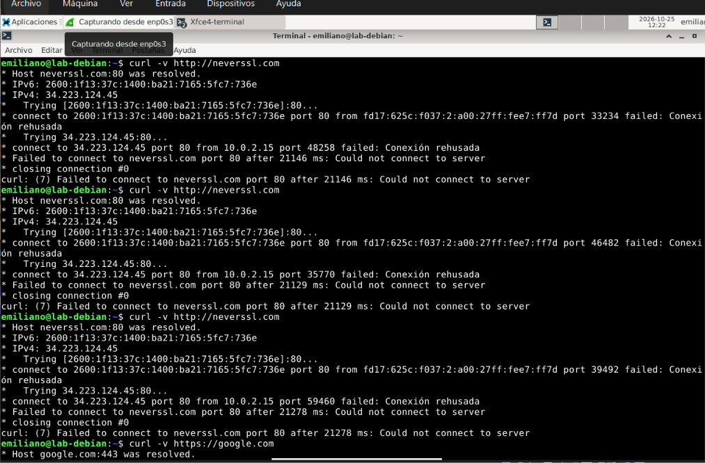

### El sitio que terminé usando: info.cern.ch

> **Host analizado en toda la práctica: `info.cern.ch`** (en reemplazo de `neverssl.com`, que no fue accesible desde mi red).

Como necesitaba una página que funcionara con HTTP puro, sin redirigir a HTTPS, elegí **`http://info.cern.ch`**, la página del CERN donde nació la web. Tiene el mismo objetivo que neverssl.com y sirve igual para este análisis.

| Dato | Valor |
|---|---|
| **Host analizado** | `info.cern.ch` |
| **Por HTTP** | `http://info.cern.ch` (puerto 80) |
| **Por HTTPS (para comparar)** | `https://info.cern.ch` (puerto 443) |
| **IP del servidor** | `188.184.67.127` |
| **Mi equipo** | Debian en VirtualBox, IP `10.0.2.15` |
| **Herramientas** | Firefox 153, DevTools y Wireshark |

---

## Evidencia observada

### ¿Qué protocolo usa el sitio?

Usa **HTTP**, sin cifrado. Firefox lo marca como "Inseguro" al lado de la dirección, y la URL aparece como `http://info.cern.ch`.

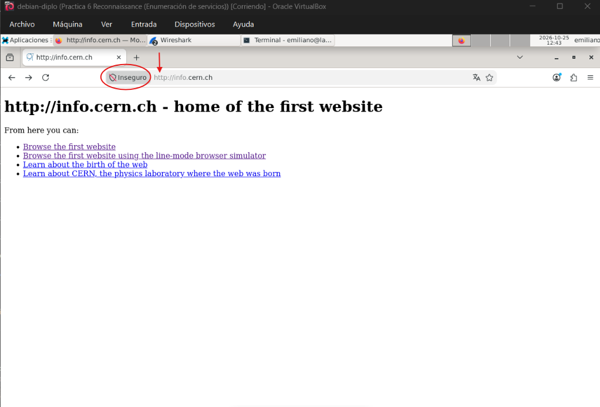

### Lo que se ve desde el navegador (F12 → Red)

En la primera solicitud se ve la URL completa (`GET http://info.cern.ch/`), el método **GET**, el estado **200 OK** y la versión **HTTP/1.1**. Más abajo están los encabezados que mi navegador mandó, entre ellos el `Host`, el `User-Agent`, el `Accept` y el `Accept-Language`.

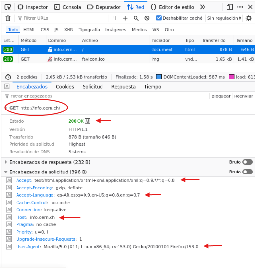

### Lo que se ve desde la red (Wireshark)

Dejé Wireshark capturando en la interfaz `enp0s3` mientras abría la página, y filtré por `http`. Ahí aparece el `GET` que sale de mi máquina (`10.0.2.15`) hacia el servidor, y su respuesta `200 OK`. Al abrir el paquete, todo está escrito en texto normal, sin ningún tipo de protección:

- **Método:** `GET`
- **Recurso pedido:** `/hypertext/WWW/TheProject.html`
- **Host:** `info.cern.ch`
- **User-Agent:** `Mozilla/5.0 (X11; Linux x86_64; rv:153.0) Gecko/20100101 Firefox/153.0`
- **Accept-Language:** `es-AR,es;q=0.9,en-US;q=0.8,en;q=0.7`
- **Referer:** `http://info.cern.ch/` (de qué página venía)

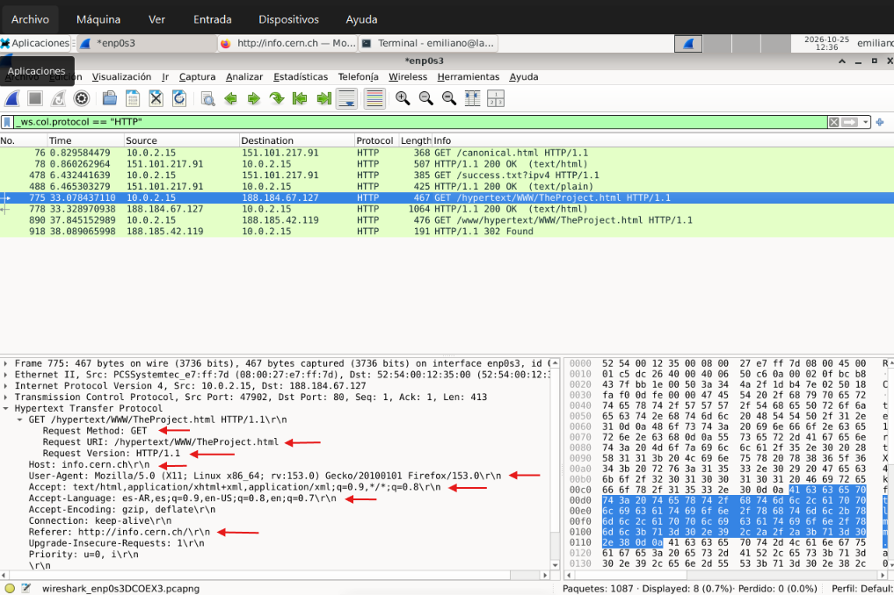

Lo que más me impactó fue la opción **Follow → HTTP Stream**. Con un clic aparece la conversación completa, tal cual pasó: lo que pidió mi navegador arriba y, abajo, la página que respondió el servidor (hasta se lee el HTML y que el servidor es un Apache). En una Wi-Fi pública, alguien conectado a la misma red y con herramientas de captura (*sniffing*) podría ver tráfico HTTP de este tipo. Aclaración: mi máquina virtual usa red NAT de VirtualBox (`10.0.2.15`), por lo que en esta práctica solo capturé mi propio tráfico, no el de otros usuarios; en una red real, qué tanto puede ver un atacante depende de la seguridad de la red (cifrado Wi-Fi, aislamiento de clientes, etc.).

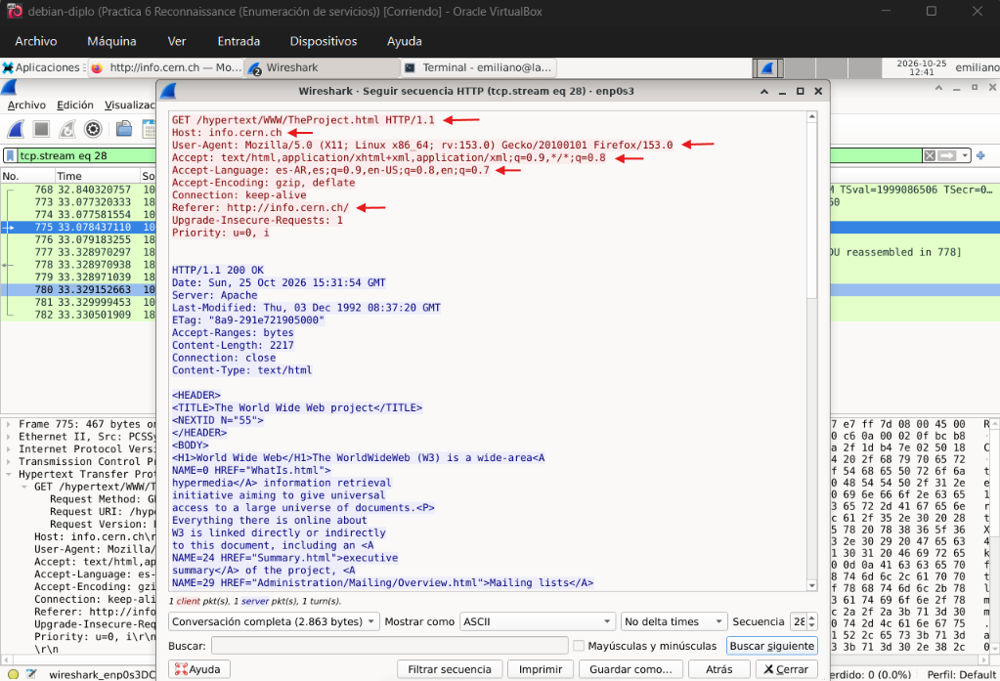

> **Dato curioso:** en la captura también aparecieron un par de pedidos HTTP que yo no hice (`/canonical.html` y `/success.txt`). Por lo que vi, son comprobaciones automáticas que hace Firefox para saber si hay internet. O sea que hasta sin tocar nada, el navegador va dejando rastros legibles en la red.

### Lo mismo, pero con HTTPS

Repetí la prueba con `https://info.cern.ch`. Ahora Firefox muestra el candado y el panel dice **"Conexión segura"**.

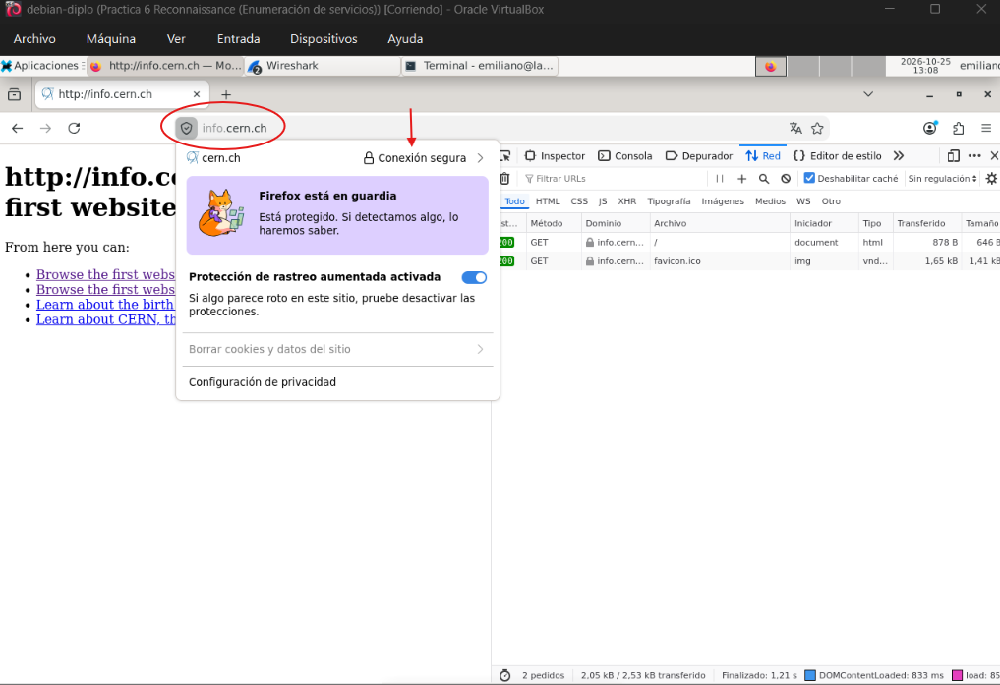

En las DevTools la solicitud ahora aparece como `GET https://info.cern.ch/`, con un candado en la columna *Dominio*. Hay que aclarar que el navegador sí ve todo esto en claro, porque es quien lo arma y lo recibe. La diferencia está en lo que viaja por la red.

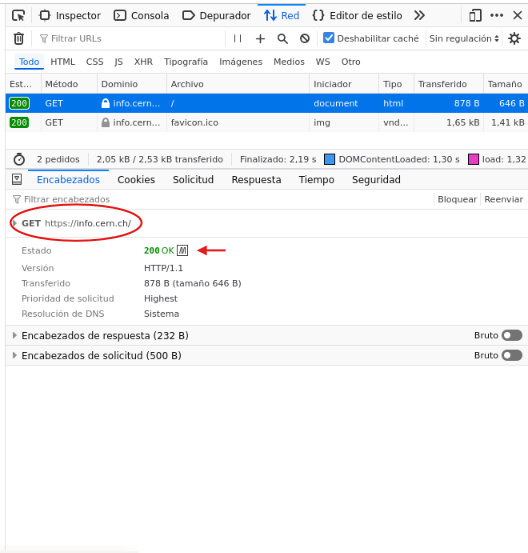

En Wireshark la historia cambia bastante. Ya no aparece ningún paquete `HTTP`; en su lugar hay una conexión TLS (la capa que cifra). La primera pieza es el **Client Hello**, donde mi navegador "saluda" al servidor antes de empezar a cifrar.

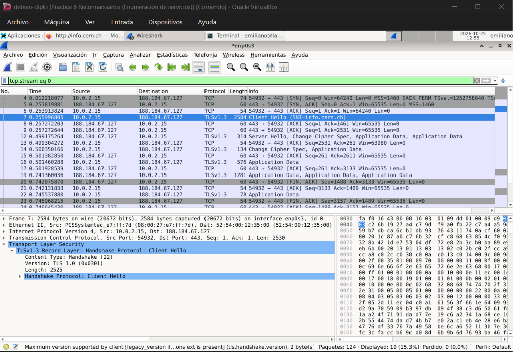

Ahí descubrí algo importante: aunque el contenido va cifrado, **el nombre del sitio sigue visible** (campo `server_name`, que dice `info.cern.ch`). Es decir, quien espía no ve qué páginas leo ni qué datos mando, pero sí sabe a qué sitio me conecté.

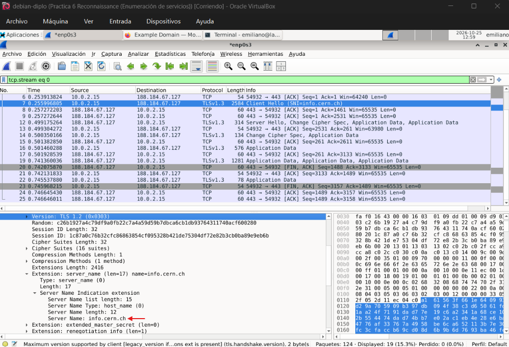

Después del saludo, los paquetes se llaman *Application Data* y Wireshark los marca como **"Encrypted Application Data"**: una tira de bytes sin sentido.

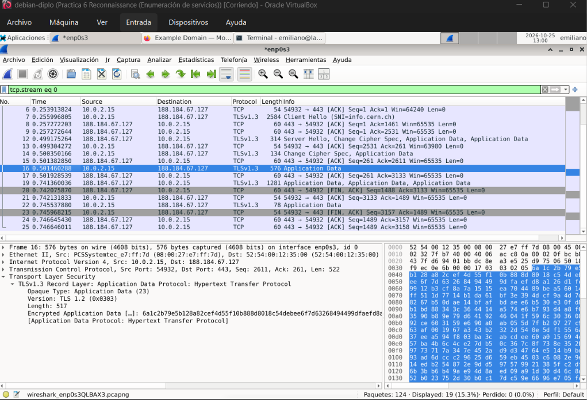

Y al hacer el Follow de la conexión, lo que se ve es puro ruido ilegible, que es el contraste directo con la captura del Follow HTTP Stream de más arriba. (Con la opción "TLS Stream" me quedaba en blanco: lo entendí como que Wireshark no tiene la clave para descifrar, así que no puede mostrar nada, justamente porque el cifrado funciona.)

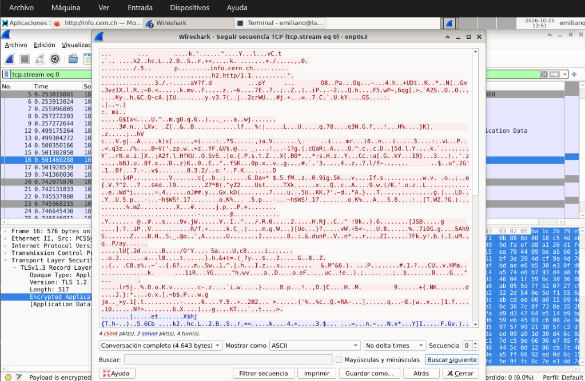

### Comparación rápida

| | HTTP | HTTPS |
|---|---|---|
| ¿Se lee el contenido de la página? | Sí, completo | No, aparece cifrado |
| ¿Se ve la página exacta que pedí? | Sí (`/hypertext/WWW/TheProject.html`) | No |
| ¿Se ven mis encabezados (navegador, idioma)? | Sí | No |
| ¿Se ve a qué sitio me conecto? | Sí | Sí (por el nombre del servidor y la IP) |
| Aviso del navegador | "Inseguro" | Candado, "Conexión segura" |

---

## Riesgos encontrados

Después de ver todo esto, estos son los riesgos que identifiqué al navegar por HTTP desde una Wi-Fi pública:

1. **Que me lean lo que veo (*sniffing*).** Todo el contenido de la página viaja como texto. Si en vez de una página informativa fuera un foro, un mail o una red social, quien escucha podría leerlo.
2. **Que se roben lo que envío.** Si completara un formulario o un login en un sitio HTTP, el usuario y la contraseña saldrían tal cual. Lo mismo con las cookies de sesión: con ellas alguien podría hacerse pasar por mí sin saber mi clave.
3. **Que me conozcan.** Sin que yo escriba nada personal, salen mi navegador y su versión, mi sistema operativo, mi idioma (y de ahí, más o menos, mi región) y las páginas que visito. Con eso se pueden armar mis hábitos. Todo esto pasa con solo navegar: no hace falta que yo descargue nada para quedar expuesto.
4. **Que me cambien lo que veo.** Si alguien se pone en el medio de la conexión (ataque *Man-in-the-Middle*), puede modificar la página antes de que llegue a mi pantalla, por ejemplo para meterle un link malicioso.
5. **Conectarme a una red falsa.** Con una red "gemela" (*Evil Twin*) con un nombre parecido al del local, el atacante tendría por delante todo mi tráfico sin que yo lo note.

Algo que también me dejó pensando: que una Wi-Fi tenga contraseña no la hace segura. Si la clave se la dan a todos los clientes, todos tienen la misma "llave".

---

## Cómo ayuda una VPN

No instalé ninguna VPN para esta práctica, pero con lo que vi en Wireshark se entiende bastante bien qué cambiaría.

Una VPN arma un **túnel** entre mi equipo y un servidor de la VPN. Todo lo que mi computadora manda se **cifra** antes de salir y se mete dentro de otro paquete, que es lo que se llama **encapsulamiento**. Ese paquete viaja por la Wi-Fi pública hasta el servidor de la VPN, que lo abre y recién ahí lo envía al sitio de destino. Es como mandar una carta dentro de un sobre blindado: el que mira desde afuera ve el sobre, pero no lo que hay adentro ni a quién va dirigida la carta de adentro.

Aplicado a lo que capturé:

- **Cifrado:** hasta una página en HTTP, que en mi captura se leía completa, viajaría protegida dentro del túnel. Lo que vería el atacante sería lo mismo que vi en mi captura HTTPS: bytes sin sentido.
- **Túnel seguro:** el atacante ya no vería conexiones hacia `info.cern.ch` ni hacia ningún sitio. Solo vería una conexión constante hacia un único destino, el servidor de la VPN.
- **Protección del tráfico:** también quedaría tapada la parte que HTTPS deja a la vista, como el nombre del sitio al que me conecto, porque eso también va adentro del túnel.
- **Privacidad:** quien comparte mi Wi-Fi no podría saber qué páginas visito ni armar un perfil mío a partir de mis encabezados.

Eso sí, la VPN no resuelve todo. La confianza pasa a depender de quien da el servicio de VPN, que sí puede ver mi tráfico, y no me protege si yo mismo entro a una página falsa o descargo algo malicioso.

---

## 3 Reglas de Oro

1. **Si la página no es HTTPS, no pongo ningún dato.** Antes de escribir una contraseña, un mail o un número de tarjeta, miro que haya candado y que diga "Conexión segura". Si el navegador marca "Inseguro", me voy.
2. **En una red pública, uso VPN.** Si no tengo, evito hacer trámites sensibles (banco, billeteras, cuentas de trabajo) y, si puedo, uso mis datos móviles o el hotspot de mi celular.
3. **Confirmo el nombre de la red antes de conectarme y apago la conexión automática.** Le pregunto al local cómo se llama exactamente su Wi-Fi para no caer en una red gemela, y desactivo que mi equipo se conecte solo a redes abiertas.

---

## Conclusión

Con esta práctica comprobé que en HTTP cualquiera que capture el tráfico puede leer el contenido, la página exacta que pido y mis encabezados (navegador, sistema, idioma). Con HTTPS el contenido y los encabezados viajan cifrados, aunque el nombre del sitio sigue visible por el SNI y la IP. Una VPN agrega otra capa: oculta también a qué sitios me conecto, pero traslada la confianza al proveedor del servicio. Por eso la mejor defensa combina HTTPS, VPN y hábitos prudentes en redes públicas.

---

## Archivos del repositorio

```
practica-wifi-segura/
├── README.md
└── imagenes/
    ├── 01-intento-neverssl-curl.png
    ├── 02-navegador-http-inseguro.png
    ├── 03-devtools-http-headers.png
    ├── 04-wireshark-http-get.png
    ├── 05-wireshark-follow-http-stream.png
    ├── 06-navegador-https-conexion-segura.png
    ├── 07-devtools-https.png
    ├── 08-wireshark-client-hello.png
    ├── 09-wireshark-sni-visible.png
    ├── 10-wireshark-application-data-cifrado.png
    └── 11-wireshark-follow-tcp-ilegible.png
```
